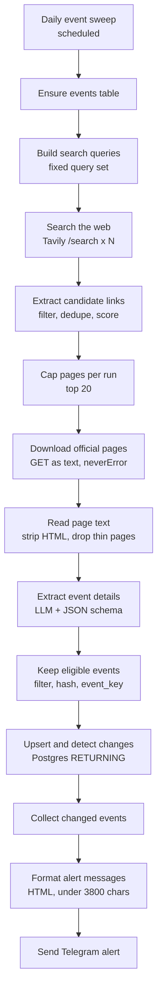

# Tech Event Radar

A configurable n8n workflow that looks for upcoming technology events in a city or region you choose, opens each candidate's official page, and keeps what it finds in Postgres. It sends a Telegram message only when an event is new, or when something about a known event has actually changed.

Search results are used to find candidate pages and nothing else. No snippet is treated as fact. Each page is downloaded, an LLM reads the text on that page, and the event has to pass a few rules before it gets stored.

The workflow ships tuned for one city as a working example. City names, search terms, trusted event sites and area coverage are plain arrays inside three Code nodes, so moving the radar to another region means editing those arrays. Details in [Make it yours](#make-it-yours).


---

## Design notes

Search finds candidates, the official page decides what is true. Snippets go stale and often describe last year's edition, so every candidate gets fetched and read before it is stored. That costs one HTTP call per candidate and removes most of the noise.

State lives in Postgres instead of n8n static data or node memory. Re-running the workflow, running it by hand, or rebuilding it cannot produce a second round of alerts for events already announced.

Change detection is a SHA-256 hash over the fields a reader cares about. Rewording a description does not alert. A moved deadline does.

Nothing about the location is baked into the logic. Retargeting to a new city means editing four arrays, with no new nodes and no rewiring.

---

## Make it yours

Every region-specific value lives in a named node. There is no config file and no code outside n8n.

| What to retarget | Node | Edit |
|---|---|---|
| City or region | *Keep eligible events* | the `cities` array (the location gate) |
| City or region in ranking | *Extract candidate links* | the `cities` array (score bonus) |
| What gets searched | *Build search queries* | the `queries` array, one item per query |
| Trusted platforms | *Extract candidate links* | `trusted` (URL substrings, +2 each) |
| Event keywords | *Extract candidate links* | `eventWords` (+1 each) |
| Pages per run | *Cap pages per run* | max items, your cost ceiling |
| Delivery time | *Daily event sweep* | hour (workflow timezone) |
| Which changes alert you | *Keep eligible events* | the `materialHash` object |
| Message wording | *Format alert messages* | header, emoji, field order |
| Recipient | *Send Telegram alert* and the error handler's *Send failure alert* | chat ID |
| Model | *OpenAI Chat Model* | model name |

### Retargeting checklist

1. Location gate. In *Keep eligible events*, replace the place-name list. The match is a case-insensitive substring test on `city + venue + description`:

   ```js
   const cities = ['bengaluru', 'bangalore', 'whitefield', 'electronic city'];
   const haystack = `${city} ${venue} ${description}`.toLowerCase();
   const inArea = cities.some(c => haystack.includes(c));
   ```

   A place-name whitelist stands in for a geographic radius. It is fast and conservative, and an event gets dropped rather than queued when none of those strings appear, so include suburbs and neighbouring towns liberally.

2. Search coverage. In *Build search queries*, one item per string:

   ```js
   const queries = [
     'hackathon Bengaluru 2026 registration',
     'AI workshop Bengaluru 2026',
     'developer meetup Bengaluru 2026',
     'site:lu.ma Bengaluru AI workshop',
     'site:unstop.com hackathon Karnataka',
   ];
   return queries.map(query => ({ json: { query } }));
   ```

   Broad queries beat narrow ones. Each one costs a single credit and the tight filtering happens later, so a noisy query is cheap while a narrow one silently misses events. Five to ten is the useful range. Mix generic intent ("hackathon <city>") with local community names and a couple of `site:` searches.

3. Trusted sources. In *Extract candidate links*, `trusted` is matched as substrings against the URL. Keep the global event platforms and add local ones: a university events page, a community site, a coworking space calendar.

4. Keep both city lists in sync. The same array appears in *Extract candidate links*, where it adds +2 to regional results, and in *Keep eligible events*, where it gates them. If the two lists disagree, the ranking and the gate disagree.

5. Prompt. *Extract event details* asks for "why a local developer cares" in `practical_relevance`. Name your city there if you want sharper copy, and adjust the date or timezone wording if you run outside IST.

6. Message header. *Format alert messages* builds the digest title, so set it to your own city name.

Changing the `event_key` inputs or the material hash invalidates existing keys. The next run re-inserts every event as new and sends a full digest once. Changing cities, queries, trusted domains or message wording is safe.

---

## How it works



Each stage passes items to the next. A stage that produces zero items ends the run quietly. N queries feed up to 20 pages, which feed at most one digest.

---

## Node reference

| # | Node | Type | Role |
|---|---|---|---|
| 1 | Daily event sweep | Schedule Trigger | Scheduled run, workflow timezone applied |
| 2 | Ensure events table | Postgres `executeQuery` | `CREATE TABLE IF NOT EXISTS tech_event_watch` |
| 3 | Build search queries | Code | One `{ query }` item per configured query |
| 4 | Search the web | HTTP Request to Tavily | One search per query, 8 results each |
| 5 | Extract candidate links | Code | Merge, filter, dedupe, score |
| 6 | Cap pages per run | Limit (20) | Cost ceiling for the whole run |
| 7 | Download official pages | HTTP Request | Fetch each URL as text |
| 8 | Read page text | Code | Strip HTML, drop thin and JS-only pages |
| 9 | Extract event details | LLM Chain and Structured Output | 18-field event object per page |
| 10 | Keep eligible events | Code | Eligibility gate, plus hashing |
| 11 | Upsert and detect changes | Postgres `executeQuery` | `ON CONFLICT` upsert with `RETURNING` |
| 12 | Collect changed events | Code | Keep rows with `material_changed = true` |
| 13 | Format alert messages | Code | HTML blocks, chunked under 3,800 chars |
| 14 | Send Telegram alert | Telegram `sendMessage` | Digest to the configured chat |

Canvas groups: *Find candidate events* (3-6), *Verify official pages* (7-9 plus the schema and model sub-nodes), *Alert on new events* (10-14).

### 1 · Daily event sweep

Single schedule rule: hour 09, no minute offset, no weekday restriction. It fires in the workflow timezone, so changing the timezone moves the run without touching the node.

### 2 · Ensure events table

`CREATE TABLE IF NOT EXISTS tech_event_watch (...)` runs once per execution. A second run changes nothing, and the statement recreates the table if someone drops it. `alwaysOutputData` keeps the chain alive since DDL returns no rows.

### 3 · Build search queries

One item per query in the array. The default set is a worked example of the pattern: generic intent, local organisers, and platform-scoped searches.

| Example query | Purpose |
|---|---|
| `hackathon <city> <year> registration` | generic intent |
| `AI workshop <city> <year>` | topic and place |
| `developer meetup <city> <year>` | meetups |
| `TinkerHub events <city>` | local community |
| `TinkerSpace <city> events` | local space |
| `technology competition <state> students <year>` | student circuit |
| `agentic AI meetup <state> <year>` | niche topic |
| `coding workshop <city> registration` | evergreen |
| `site:luma.com <city> AI workshop` | platform-scoped |
| `site:unstop.com hackathon <state>` | platform-scoped |

The mix matters more than the count. Two or three `site:` queries against event platforms surface things a normal web search buries.

### 4 · Search the web

`POST https://api.tavily.com/search` with a 20 s timeout:

```json
{
  "query": "<from previous node>",
  "search_depth": "basic",
  "topic": "general",
  "country": "india",
  "max_results": 8,
  "chunks_per_source": 2
}
```

`search_depth: basic` costs one credit per query. `country` takes a single value, so set it for your region. Auth uses Simplified Custom Auth to add an `Authorization: Bearer` header, and the credential holds only the key.

### 5 · Extract candidate links

The node flattens `results[]` from every response, then drops:

- non-HTTP URLs and file downloads (`.pdf`, `.zip`, `.doc(x)`, `.xls(x)`, `.ppt(x)`)
- tag, category, author, search, pagination and feed URLs
- duplicate URLs across queries, using a per-run `Set`

It truncates `title` to 300 chars and `snippet` to 1,200, then scores each candidate:

| Signal | Points |
|---|---|
| URL on a trusted domain (default: lu.ma, luma.com, unstop.com, devfolio.co, tinkerhub.org, tinkerspace, meetup.com, konfhub.com, eventbrite, hasgeek.com, fossunited.org) | +2 |
| A place name from `cities` in the title or snippet | +2 |
| An event word (hackathon, workshop, bootcamp, meetup, conference, summit, competition, hack night, build night, demo day, devfest, webinar, training, sprint, ctf) | +1 |
| An upcoming year | +1 |

Output is sorted by score, highest first. The score only reorders the queue. It never adds an event.

### 6 · Cap pages per run

Limit node set to 20 items. This is the cost gate: 20 pages means at most 20 downloads and 20 LLM calls. Lower it to spend less, raise it for wider coverage.

### 7 · Download official pages

GET per candidate as text, with a browser User-Agent, up to 5 redirects and a 15 s timeout. Requests are batched 5 at a time with a 500 ms interval so the run does not look like a burst. `neverError` is on, so a dead link or a 403 arrives as an item with an error payload instead of killing the run, and the next node drops it.

### 8 · Read page text

Strips `script`, `style` and `noscript`, removes all tags, decodes common entities, collapses whitespace. Pages under 500 chars of raw HTML are treated as error pages. Pages under 200 chars of text are treated as JavaScript shells. Both get dropped. Survivors are cut to 12,000 characters and paired back to their `url` and `title` from *Extract candidate links* by index, which works because the HTTP node preserves input order.

Sites that render entirely in JavaScript come back as an empty shell and get skipped. That is a limit of text extraction.

### 9 · Extract event details

LLM Chain with a Structured Output Parser (`Event schema`, 18 required fields). The prompt is strict on purpose:

- only information explicitly written on the page, no guessing or inferring
- `""` for anything the page does not state
- `start_date` as `YYYY-MM-DD`, otherwise `""`
- `is_technical` only for software, AI, data, hardware, robotics, cybersecurity or developer tooling
- `is_hands_on` only for workshops, hackathons, labs, build sessions and sprints
- an empty `name` when the page is not about one specific event (blog post, news article, course catalogue, job ad, listing index, generic community page) or the event already happened
- `description` under 300 chars and `practical_relevance` under 200 chars, answering "why a local developer cares"
- today's date injected at runtime

Schema fields: `name`, `organizer`, `event_type`, `start_date`, `start_time`, `city`, `venue`, `registration_status`, `registration_deadline`, `fee`, `eligibility`, `team_size`, `registration_url`, `official_url`, `description`, `practical_relevance`, `is_technical`, `is_hands_on`.

Model: `gpt-5.4-mini` through the OpenAI credential. No `temperature` is set, because that model rejects the parameter and the node fails when it is sent. `onError: continueRegularOutput` means one bad extraction does not stop the run. The item arrives without a name and gets dropped next.

If you swap models, check that the new one accepts the options you set and that its output still matches what the next node expects. Different models also drift more or less in wording, which feeds the key-drift limitation below.

### 10 · Keep eligible events

This node is the gatekeeper, and it is where identity gets created. It unwraps `output`, `text` and JSON-string variants, then checks in order:

1. The item needs a name. Empty names are dropped.
2. `is_technical` must be `true`.
3. Location. `city + venue + description` must contain one of the configured `cities` entries.
4. Registration status. Anything containing closed, sold out, ended or full is dropped. What remains must contain open, pending, not stated, register or coming. Unrecognised phrasing is dropped instead of guessed.
5. Date. `start_date` must be `YYYY-MM-DD`, must parse, and must not be before today in the workflow timezone. This check is deterministic, so it does not depend on the model's judgement.

Survivors get two hashes:

| Hash | Inputs | Purpose |
|---|---|---|
| `event_key` | `sha256(normalize(name) \| normalize(organizer) \| start_date)` | Primary key, the dedupe identity across days |
| `material_hash` | `sha256(start_date, start_time, status bucket, deadline, registration_url, fee)` | What actually changed |

Status is bucketed to `open`, `closed`, `unknown` or `other` before hashing, so phrasing drift does not fire an alert. Neither does a reworded description or a corrected venue. Only fields inside `materialHash` can produce a changed alert, which makes that object the knob for how chatty the radar is.

### 11 · Upsert and detect changes

One parameterised statement per event, with parameters `$1` to `$10` and `queryBatching` set to `independently`:

```sql
INSERT INTO tech_event_watch (...) VALUES (..., TRUE)
ON CONFLICT (event_key) DO UPDATE SET
  ...,
  material_changed = (tech_event_watch.material_hash IS DISTINCT FROM EXCLUDED.material_hash),
  last_checked_at  = NOW(),
  last_changed_at  = CASE WHEN tech_event_watch.material_hash
                            IS DISTINCT FROM EXCLUDED.material_hash
                          THEN NOW() ELSE tech_event_watch.last_changed_at END
RETURNING event_key, name, ..., material_changed, first_seen_at, last_changed_at;
```

This is what makes the workflow idempotent. Running it twice in a row sends nothing the second time. `first_seen_at` is written once, `last_checked_at` moves on every run, and `last_changed_at` moves only on a material change.

### 12 · Collect changed events

Keeps rows whose `material_changed` is truthy, accepting `true`, `'true'`, `'t'` and `1` because drivers differ. If nothing survives, the branch ends and no message goes out.

### 13 · Format alert messages

One HTML block per event, packed into chunks of at most 3,800 characters. Telegram's hard limit is 4,096 and the margin covers the header and HTML entities. Every chunk repeats the digest header:

```
<City> tech events - 21 Oct 2026
```

Each block opens with 🆕 when `first_seen_at` equals `last_changed_at` (brand new) and 🔄 otherwise (changed). Then the event name in bold, followed by whichever lines have data: date and time, venue and city, registration status, deadline, fee, eligibility, team size, the relevance sentence, the registration link, and the source page when it differs from the registration link. Values are HTML-escaped before insertion.

### 14 · Send Telegram alert

`sendMessage` with `parse_mode: HTML`, link previews off and attribution off. One item per chunk means one message per chunk.

---

## Data model

Table `tech_event_watch`:

| Column | Type | Meaning |
|---|---|---|
| `event_key` | TEXT PRIMARY KEY | SHA-256 of name, organizer and start date |
| `name` | TEXT NOT NULL | Event name as written on the page |
| `organizer` | TEXT | Organising body |
| `event_date` | DATE | Start date |
| `venue` | TEXT | Venue as written |
| `registration_status` | TEXT | Raw status text from the page |
| `registration_url` | TEXT | Where to register |
| `official_url` | TEXT | Page the details were read from |
| `material_hash` | TEXT | Hash of the fields that can trigger a changed alert |
| `event_data` | JSONB NOT NULL | Full 18-field event object |
| `material_changed` | BOOLEAN NOT NULL DEFAULT TRUE | Output flag of the last upsert, not stored truth |
| `first_seen_at` | TIMESTAMPTZ | When the event was first inserted |
| `last_checked_at` | TIMESTAMPTZ | Last run that saw the event |
| `last_changed_at` | TIMESTAMPTZ | Last run where the material hash changed |

The table name has no city in it, so one database can hold several radars. Run one workflow per city, or add a `region` column and include it in `event_key`.

### Useful queries

```sql
-- upcoming events, soonest first
SELECT name, event_date, venue, registration_status, registration_url
FROM tech_event_watch
WHERE event_date >= CURRENT_DATE
ORDER BY event_date;

-- what changed recently
SELECT name, last_changed_at, registration_status
FROM tech_event_watch
WHERE last_changed_at > NOW() - INTERVAL '7 days'
ORDER BY last_changed_at DESC;

-- events nothing has checked lately
SELECT name, last_checked_at FROM tech_event_watch
ORDER BY last_checked_at ASC LIMIT 20;
```

---

## Setup

You need n8n with the Postgres, Telegram and LangChain nodes available, a Postgres database the workflow can write to, a [Tavily](https://tavily.com) API key (the free tier is enough), an OpenAI API key for the configured model, and a Telegram bot plus the chat ID to post to.

### 1 · Import the workflow

```bash
# from the n8n UI: Workflows -> Import from File
# or via CLI
n8n import:workflow --input=src/workflows/tech-event-radar.workflow.json
```

### 2 · Create the credentials

| Credential | Type | Used by |
|---|---|---|
| Tavily key | Simplified Custom Auth, adds an `Authorization: Bearer` header | Search the web |
| OpenAI key | OpenAI API | Extract event details |
| Postgres connection | Postgres | Ensure events table, Upsert and detect changes |
| Telegram bot | Telegram API | Send Telegram alert, error handler |

No secret sits in the workflow source. Nodes reference credentials by ID. After importing, reselect each credential in its node, because imported IDs will not resolve on another instance.

### 3 · Point it at your chat

Update the chat ID in *Send Telegram alert* and in the error handler's *Send failure alert*. Send `/start` to the bot once from that chat so it is allowed to message you.

### 4 · Point it at your region

Work through the [retargeting checklist](#retargeting-checklist): `cities` in both Code nodes, the `queries` array, `trusted` domains and the message header. No node rewiring needed.

### 5 · Test before scheduling

1. Run *Execute workflow* by hand. Publishing is not required.
2. Follow one item through *Search the web*, *Extract candidate links*, *Download official pages*, *Read page text* and *Extract event details*. Check that the page text is real content and not an error page.
3. Check that *Keep eligible events* returns real local events with future dates. An empty result usually means the `cities` list or the queries are too narrow.
4. Check *Upsert and detect changes*. The first run sets `material_changed = true` on every row. An immediate second run sets it to `false` everywhere and sends no Telegram message.
5. Trigger a failure once to confirm the error handler's alert arrives, then delete the test message.

### 6 · Activate

Turn the workflow on. The schedule does not catch up after downtime, so run it by hand once if you miss a day.

---

## Configuration

| Want to change | Where |
|---|---|
| Delivery time | *Daily event sweep* → hour (workflow timezone) |
| Search coverage | *Build search queries* → the `queries` array |
| Trusted domains, event words | *Extract candidate links* → `trusted`, `eventWords` |
| Pages per run (cost ceiling) | *Cap pages per run* → max items |
| Area covered | *Keep eligible events* → `cities`, and *Extract candidate links* → `cities` |
| Which fields trigger a changed alert | *Keep eligible events* → `materialHash` object |
| Message wording and links | *Format alert messages* |
| Recipient | *Send Telegram alert* and the error handler's *Send failure alert* |
| Model | *OpenAI Chat Model* |

---

## Failure handling

| Failure | Behaviour |
|---|---|
| Bad, unreachable or blocked page | `neverError` gives empty text, dropped in *Read page text* |
| Thin page, non-event page, wrong city, past event, closed registration | Dropped in *Keep eligible events* |
| LLM call fails or returns junk | `continueRegularOutput`, dropped at the name check |
| Tavily auth error, Postgres down, Telegram rejected | Run aborts, error workflow posts a Telegram alert |
| Nothing new or changed | Silent run, no message |

The error workflow is `On workflow failure` (Error Trigger) → `Format failure alert` → `Send failure alert`. The alert carries the workflow name, the last node executed, the error message truncated to 600 chars, the execution mode, the execution ID and its URL.

---

## Cost and runtime

| Item | Per run |
|---|---|
| Tavily credits | 1 per query (10 by default) |
| Page downloads | 20 at most |
| LLM calls | 20 at most, each under 12k chars |
| Telegram messages | 0 when nothing changed, 1 or more otherwise |
| Runtime | A few minutes, mostly downloads and LLM calls |

Cost grows with the number of queries and is capped by the page limit, so *Cap pages per run* is the first knob to turn down.

---

## Known limitations

1. The same event can land in two rows. `event_key` hashes the model's own wording of name, organizer and date, so if a page reads slightly differently on two days the key differs, a second row appears and you get a repeat alert. Narrowing the material hash and bucketing the status reduced this but did not remove it. Anchoring `event_key` on the registration URL, domain plus slug, would fix it properly.
2. Area is a place-name whitelist. Events near your city whose venue and description never mention one of the configured names are missed. Add suburbs and neighbouring towns liberally.
3. JavaScript-rendered pages get skipped because the extractor only sees the empty shell.
4. The query set is fixed. A new kind of event that none of the queries surface will not be found until you add one.
5. Registration status phrasing is narrow. Only recognised word stems count, so something like "applications paused" gets dropped instead of guessed.
6. `registration_status` stores free text as written on the page. Only the hash uses a normalised bucket.

---


